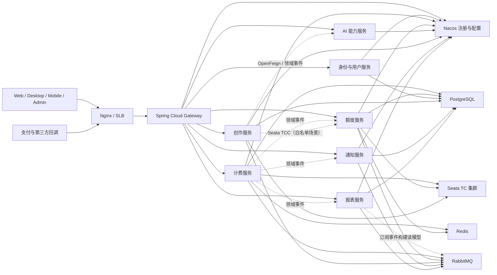
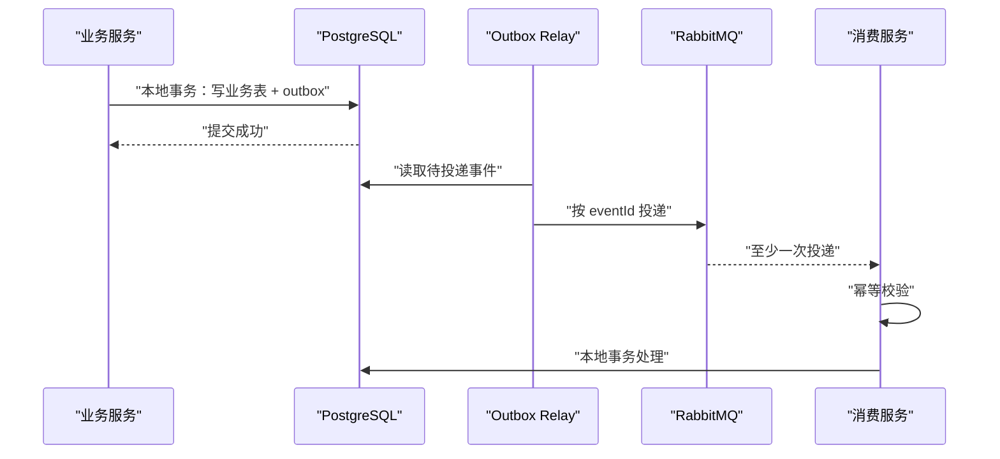

# DramaIP 后端技术架构

> 状态：当前架构
> 基线：JDK 21、Spring Boot 4.0.6、Spring Cloud 2025.1.0、Spring Cloud Alibaba 2025.1.0.0
> 适用目录：`dramaip-platform/server/`

## 1. 文档目标

本文定义 DramaIP Java/Spring Cloud Alibaba 后端的服务边界、工程结构、开发规范和运行约束。

## 2. 核心架构决策

1. 对外入口统一为 Spring Cloud Gateway，不设置按 Web、桌面端、移动端、管理端拆分的后端适配服务。
2. 客户端通过网关直接访问所属业务微服务；网关只处理通用流量治理，不编排业务和访问数据库。
3. 采用国内团队常见的分层架构：`Controller -> Service -> Manager（按需）-> Mapper`，不强制套用复杂领域建模。
4. 采用 Maven 多模块工程：根父 POM 统一版本，按「基础设施层 + 业务服务层」两级组织——公共能力（common）与网关（gateway）置于顶层，业务服务置于 `services/` 子层，模块名不带 `dramaip-` 前缀，HTTP 契约由 OpenAPI 管理。
5. 服务注册与配置使用 Nacos，流量治理使用 Sentinel，服务间同步调用使用 HTTP + OpenFeign。
6. 消息中间件统一使用 RabbitMQ，沿用现有 exchange、queue 和 routing key 语义并逐步规范化。
7. 数据访问以 MyBatis-Plus 为主，复杂查询和账务 SQL 使用 MyBatis XML 显式编写。
8. 引入 Seata 2.5.0 作为分布式事务基础设施，AT/TCC 只用于经过评审的短事务场景。
9. RabbitMQ 不参与 Seata 全局事务；跨数据库与消息的一致性仍采用本地事务、幂等、事务发件箱和补偿。
10. Java 编码、数据库、异常、日志、并发和单元测试规则以《阿里巴巴 Java 开发手册》及 P3C 检查规则为最低基线。
11. Spring Boot 版本固定为 `4.0.6`，不得由子模块自行覆盖。

## 3. 总体架构

### 3.1 目标形态



### 3.2 请求链路

标准请求链路如下：

```text
客户端
  -> Nginx / SLB
  -> Spring Cloud Gateway
  -> 业务服务 Controller
  -> Service / ServiceImpl
  -> Manager（存在跨 Mapper 复用或第三方能力封装时）
  -> Mapper / OpenFeign / RabbitMQ
```

约束：

- 网关负责路由、跨域、请求标识、黑白名单、统一限流和令牌初步校验。
- 业务鉴权必须在服务内再次执行，不能只依赖网关。
- 网关禁止聚合业务数据、编写业务规则和直接访问数据库。
- 客户端差异由前端适配；后端接口按业务能力设计，不按客户端类型复制服务。
- 单一业务服务拥有的接口直接由该服务提供。
- 少量实时跨服务查询由明确的业务归属服务编排，调用数量应受控。
- 首页、看板和复杂统计通过 `reporting` 的读模型提供，避免请求时串行调用多个服务。
- 长流程通过领域事件和状态机推进，不使用同步调用链串联所有服务。

## 4. 技术栈

| 领域 | 目标选型 | 约束 |
|---|---|---|
| JDK | JDK 21 | CI、镜像和生产环境保持一致 |
| 基础框架 | Spring Boot 4.0.6 | 父工程锁定，不允许子模块降级 |
| 微服务版本线 | Spring Cloud 2025.1.x | 通过 BOM 统一管理 |
| 阿里生态版本线 | Spring Cloud Alibaba 2025.1.x | 实施前验证与 Boot 4.0.6 的完整依赖树 |
| 网关 | Spring Cloud Gateway | 目标唯一业务入口 |
| 注册与配置 | Nacos 3.x | 使用 `spring.config.import`，不使用旧 bootstrap 机制 |
| 服务调用 | OpenFeign + Spring Cloud LoadBalancer | OpenAPI 由提供方维护，Feign Client 默认放在调用方 |
| 限流熔断 | Sentinel | 网关和服务两级规则 |
| 数据访问 | MyBatis-Plus Boot 4 Starter + MyBatis | 禁止 ActiveRecord 模式 |
| 数据库 | PostgreSQL | 沿用现有数据库，不因语言迁移更换数据库 |
| 数据库迁移 | Flyway | 生产变更只允许前向、可审计脚本 |
| 缓存 | Redis + Redisson | 缓存不是账务事实来源 |
| 消息队列 | RabbitMQ + Spring AMQP | 沿用现有集群，统一消息信封、重试和死信规范 |
| 分布式事务 | Seata 2.5.0 | AT/TCC 按场景白名单使用，TC 注册和配置接入 Nacos |
| 对象转换 | MapStruct | 禁止在热路径大量使用反射式属性复制 |
| 参数校验 | Jakarta Validation | Controller 入参统一校验 |
| 接口契约 | OpenAPI 3 | Knife4j 仅作为兼容验证后的展示层 |
| 可观测性 | Actuator、Micrometer、Prometheus、OpenTelemetry | 统一日志、指标和链路标识 |
| 测试 | JUnit 5、Mockito、Testcontainers、WireMock | 关键链路必须包含集成测试 |
| 代码质量 | P3C PMD、Checkstyle、SpotBugs、JaCoCo | CI 强制门禁 |

### 4.1 版本管理原则

- 根 `server/pom.xml` 同时作为父 POM 和聚合 POM，在 `dependencyManagement` 中导入 Spring Boot、Spring Cloud、Spring Cloud Alibaba BOM。
- 初始基线使用 Spring Cloud Alibaba `2025.1.0.0`；其官方组件矩阵对应 Seata `2.5.0`。
- 业务模块不得直接声明 BOM 已管理依赖的版本号。
- 其他第三方依赖版本集中到根父 POM 属性，禁止散落在子模块。
- 当前为单仓库构建，不创建项目自己的独立 BOM 模块；只有未来多个仓库或外部项目需要复用同一版本平台时再评估拆分。
- 升级 Spring Boot 小版本前必须执行全量单元测试、集成测试、依赖漏洞扫描和启动冒烟测试。
- 如某个组件尚未声明支持 Spring Boot 4.0.6，应替换组件或等待兼容版本，不得私自降低 Spring Boot 基线。

## 5. 服务划分

### 5.1 服务清单

| 服务 | 职责 | 数据所有权 | 说明 |
|---|---|---|---|
| `gateway` | 路由、跨域、限流、请求标识、令牌初检 | 无 | 不允许业务编排和数据库依赖 |
| `identity` | 登录、令牌签发刷新登出、会话、用户、工作空间、成员关系、用户资料、管理员、角色、权限、系统配置、审计查询 | 身份、用户与系统管理数据 | 内部按 `auth`/`user`/`admin` 子包模块化；管理端直接经网关调用；同一服务内调用变本地方法，不再经 OpenFeign |
| `billing` | 订单、支付、充值、退款、账务流水、超时关闭 | 计费域数据 | 金额以最小货币单位整数存储 |
| `quota` | 额度账户、额度流水、预占、扣减、释放、到期任务 | 额度域数据 | 流水表只追加，不覆盖历史记录 |
| `ai` | 模型供应商接入、模型路由、调用策略、使用量采集 | AI 配置与调用数据 | 第三方密钥不得进入日志 |
| `creation` | 灵感、快照、评审等创作流程 | 创作域数据 | 内部按清晰子包拆分，不急于继续拆服务 |
| `notification` | 站内信、短信、邮件、模板、发送记录 | 通知数据 | 事件驱动，发送幂等；独立处理投递与失败重试 |
| `reporting` | 管理看板、统计报表、查询读模型 | 报表投影数据 | 只读投影；不回写业务主数据 |

### 5.2 业务能力归属

| 现有能力 | Java 归属 |
|---|---|
| 登录与令牌、用户与工作空间、管理账号权限和配置 | `identity`（内部 `auth`/`user`/`admin` 子包） |
| 订单、支付、充值、退款、订单超时任务 | `billing` |
| 额度账户、额度流水、额度到期任务 | `quota` |
| AI 供应商和模型调用 | `ai` |
| 灵感、快照、评审 | `creation` |
| 通知发送 | `notification` |
| 管理报表和统计 | `reporting` |
| 原端侧接口进程 | 接口按业务归属直接进入上述服务 |

### 5.3 服务拆分原则

- 一个服务必须有明确业务所有权和数据所有权，不能只是若干接口的转发壳。
- 不以团队人数、页面数量、客户端类型或数据库表数量作为拆分依据。
- 不为了“微服务化”把当前强一致的小事务拆成远程调用。
- 同一服务内部优先模块化；只有独立扩缩容、独立数据所有权或独立发布价值明确时才继续拆分。
- 定时任务归属于持有业务状态的服务，不单独复制领域逻辑。

### 5.4 服务粒度决策

按上述拆分原则，平台由七个业务服务承载核心能力：

- **`identity` 合并 `auth` + `user` + `system`（旧 admin）**：三者共享用户身份这个聚合根，登录要查用户、会话写入与用户资料强相关，管理后台是用户域的管理视图。拆成独立服务会引入 `auth ↔ user` 的 OpenFeign 回查和管理端多一跳。合并后同一服务内调用变为本地方法，无独立扩缩容差异，内部按 `auth`/`user`/`admin` 子包模块化。
- **`notification` 与 `reporting` 分立**：notification 是写入与异步投递链路，需要独立处理消费者吞吐、重试和失败隔离；reporting 是只读投影，查询负载和扩缩容特征不同。两者各自拥有 schema 最小权限并独立发布。
- **`billing` 与 `quota` 保持分立**：两者是「钱」与「Token」两种不同的只追加资源账户，对账独立、流水独立、是资金链路需故障隔离和独立灰度；即便靠 Seata TCC 联动，仍保留为两个部署单元。
- **`gateway`、`ai`、`creation` 保留不变**：gateway 是统一入口无业务状态；ai 因调用慢、需熔断隔离有独立扩缩容价值；creation 内部已是多子域模块化。

未来若某个子域出现进一步明确的独立扩缩容或独立发布价值，再按 5.3 原则评估拆分。

## 6. Maven 工程规划

以下是后续实现阶段的目标目录，不代表当前已创建：

```text
dramaip-platform/server/
├─ pom.xml                 # 父 POM、聚合模块、dependencyManagement
├─ common/                 # 基础设施层：扁平单一公共模块（初期不设嵌套子模块）
│  └─ src/main/java/com/dramaip/platform/common/
├─ migration/              # 基础设施层：唯一执行 Flyway 的无状态 Job
├─ gateway/                # 基础设施层：Spring Cloud Gateway 统一入口
└─ services/               # 业务服务层：每个子目录是一个独立可部署业务服务
   ├─ identity/            # 合并 auth + user + system（旧 admin），内部按 auth/user/admin 子包模块化
   ├─ billing/
   ├─ quota/
   ├─ ai/
   ├─ creation/
   ├─ notification/        # 站内信、短信、邮件与投递记录
   └─ reporting/           # 管理看板、统计报表与读模型
```

该结构按 Java/Maven 的构建和部署单元设计，采用两级组织：

- **基础设施层**（`server/` 顶层）：`common`、`migration`、`gateway`——它们是支撑所有业务服务的技术能力，不属任何单一业务域，置于顶层。
- **业务服务层**（`server/services/`）：`identity`、`billing`、`quota`、`ai`、`creation`、`notification`、`reporting`——每个子目录是一个独立部署单元，独立打镜像、独立扩缩容。

`server/services/` 这一子层**只为组织业务服务模块**，不是中央接口聚合模块，也不承载任何业务实体或 DTO。模块名不带 `dramaip-` 前缀（Maven artifactId 跟随模块名；Java 包名仍保留 `com.dramaip.platform.<service>` 反向域名）。公共模块必须实行白名单管理：

- `common` 初期保持扁平单模块，目录即 `server/common/src/main/java/...`，**不增设 `common/platform-common` 这类仅用于归类的嵌套层**；只有出现明确的依赖隔离或发布需求时，才拆为 `common-web`、`common-security` 等同级子模块。
- 只放稳定、跨三个及以上模块复用的技术能力。
- 禁止把业务实体、业务枚举和业务工具类放进 `common`。
- `common` 不得包含任何具体业务服务的请求、响应、DTO 或 Feign Client。
- `common` 不得依赖任何业务服务，依赖方向始终单向，禁止反向依赖。
- 新增公共模块需经过架构评审，防止形成“万能工具包”。

## 7. 单服务分层与包结构

### 7.1 设计原则：领域对象按层就近

本架构遵循《阿里巴巴 Java 开发手册》「分层领域模型规约」，**领域对象不集中放在 `model` 大包，而是就近放在所属层**：对外契约对象归 `controller/dto`，数据库对象归 `entity`，枚举归 `enums`。这样每一层一眼可读出自己允许接触的对象类型，从工程结构层面就防止「同一个对象贯穿所有分层」。

与早期的集中式 `model` 设计相比，主要变化：

- 领域对象**按层就近**，不再设一级 `model` 包。
- `enums` 从数据模型中剥离，独立成包——枚举是业务规则，不是数据模型。
- 原 `model/dataobject` 改名为 `entity`：`DO` 是**类名后缀**（如 `OrderDO`），包名不再用冗长的 `dataobject`。
- 原 `model/vo`、`model/request`、`model/query` 统一并入 `controller/dto`，作为本服务对外契约对象；`controller/dto` 内可按业务子聚合分目录。
- 原 `model/bo` 降级为按需的 `domain` 包，默认不创建。
- `convert` 是对象跨层转换的**唯一落点**，所有层间对象转换必须经 MapStruct 转换器，禁止手写 `BeanUtils.copyProperties` 跨层复制。

### 7.2 标准包结构

以计费服务为例：

```text
com.dramaip.platform.billing
├─ BillingApplication              # 启动类
├─ controller                      # 协议适配层
│  └─ dto                          # 本服务对外请求/响应契约对象（Request/Query/VO，必要时按子聚合分目录）
├─ service                         # 用例编排、业务校验、事务边界
│  └─ impl
├─ manager                         # 按需：跨 Service 复用的技术组合 / 缓存 / 第三方封装
├─ mapper                          # MyBatis 数据访问接口
├─ entity                          # 与数据库表映射的数据对象（类名带 DO 后缀，如 OrderDO）
├─ enums                           # 业务枚举，独立成包，不混入数据模型
├─ domain                          # 按需：复杂内部业务计算对象（BO），默认不建
├─ convert                         # MapStruct 对象转换器，层间转换唯一通道
├─ client                          # OpenFeign / 第三方 HTTP 客户端（调用方维护）
├─ mq
│  ├─ producer                     # 消息生产者，事件载荷使用 DTO
│  └─ consumer                     # 消息消费者，反序列化 + 幂等 + 调 Service
├─ job                             # 定时任务：抢占、选记录、调 Service
├─ config                          # Spring 配置类
└─ infrastructure                  # 本服务内部辅助：常量、异常、工具（不使用含义含混的 support 包名）
   ├─ constant
   ├─ exception
   └─ util
```

包名四段语义固定为 `com.dramaip.platform.<service>`：`dramaip` 为产品名、`platform` 为业务线、`<service>` 为第 5 章服务清单中的服务名，不再额外增减层级。

> 注：单服务内部的辅助包命名为 `infrastructure`（constant/exception/util）；不要使用含义含混的 `support` 作为业务服务或辅助包名。

### 7.3 分层职责

| 层 | 职责 | 允许接触的对象类型 | 禁止事项 |
|---|---|---|---|
| Controller | 协议适配、参数校验、调用 Service、返回结果 | 入参：`controller/dto` 内 `Request`/`Query`；出参：`controller/dto` 内 `VO` | 写业务规则、直接调用 Mapper、手写事务、返回 `DO` |
| Service | 用例编排、业务校验、事务边界 | 出入参：`DTO`/`BO`（内部对象） | 暴露 `DO`、在长事务中执行远程调用 |
| Manager | 可复用的数据库组合、缓存封装、第三方能力封装 | `DO`/`DTO` | 变成所有逻辑的中转层 |
| Mapper | 数据库读写 | 仅 `DO` | 业务判断、远程调用、接收前端 `Request` |
| Client | OpenFeign 或第三方 HTTP 客户端 | `DTO` | 自行吞掉异常、返回含义不明的空值 |
| MQ Consumer | 反序列化、幂等校验、调用 Service | 消息载荷 `DTO` → 复用 Service 入参 | 复制 Service 业务逻辑、另造一套平行模型 |
| Job | 抢占执行权、选择待处理记录、调用 Service | 复用 Service 入参 | 绕过 Service 直接更新核心状态 |

`Manager` 不是必选层。仅当一段技术性组合逻辑被多个 Service 复用，或需要隔离缓存、第三方 SDK、复杂 Mapper 组合时才创建。

### 7.4 对象流转矩阵

对象跨层流转的唯一合法路径如下，`convert` 是层间转换的唯一通道：

```text
HTTP 请求
  └─ Controller (controller/dto: Request / Query)
        └─[convert]─→ Service (DTO / BO)
                         ├─[convert]─→ Manager ─→ Mapper (DO) ─→ 数据库
                         ├─[convert]─→ mq/producer (DTO 事件载荷)
                         └─[convert]─→ client (DTO)

MQ Consumer / Job
  └─[convert]─→ Service（复用 Service 入参对象，禁止另造平行模型）
```

约束：

- 每一类对象只允许出现在上图的指定层级；`convert` 是层间转换的唯一通道，禁止绕过它手写跨层复制。
- 禁止同一个对象从 Controller 一路穿透到 Mapper（即禁止 `DO` 进 Controller、`Request` 进 Mapper）。
- MQ Consumer 与 Job 必须复用 Service 的入参对象，不得为异步入口另造一套平行模型。

### 7.5 对象命名与判定准则

| 后缀 | 归属包 | 何时使用 | 禁止 |
|---|---|---|---|
| `Request` | `controller/dto` | Controller 写入类入参，如 `OrderCreateRequest` | 进入 Mapper |
| `Query` | `controller/dto` | 列表/查询类入参 | 进入 Mapper |
| `VO` | `controller/dto` | 返回客户端的视图对象 | 与 `DO` 字段直接一一透传 |
| `DTO` | `controller/dto` 或 Service 内部 | 服务间传输；当对外契约与传输形态一致时可在 `controller/dto` 内复用 | 直接落库 |
| `DO` | `entity` | 与数据库表一一映射，类名 `XxxDO` | 出现在 Controller；作为 MQ 载荷 |
| `BO` | `domain`（按需） | **仅当**出现三个以上对象组合、复杂内部计算且被多处复用时 | 默认建包；为简单 CRUD 创建 |
| `Convert` | `convert` | MapStruct 转换器 | 手写反射式属性复制替代 |
| `Mapper` | `mapper` | MyBatis 数据访问接口 | 写业务判断 |
| `Client` | `client` | 远程服务或第三方接口客户端 | 吞异常、返回含义不明的空值 |

硬约束：

- 所有领域对象类名必须带类型后缀（`DO`/`DTO`/`VO`/`Request`/`Query`/`BO`）；无后缀的领域对象类不得合入。枚举类不带后缀，但必须放在 `enums` 包。
- 集合返回空集合而非 `null`；跨层方法的空值语义必须明确。
- 禁止 Controller 返回 `DO`，禁止 Mapper 接收前端 `Request`，禁止同一个对象贯穿所有分层。

### 7.6 资源目录约定

```text
src/main/resources/
├─ mapper/                  # MyBatis XML，按业务子域分目录
│  └─ billing/
├─ db/migration/            # Flyway 脚本：V{version}__{domain}_{slug}.sql
├─ application.yml          # 主配置（仅放引导项）
└─ application-{profile}.yml # local/test/staging/prod
```

- MyBatis XML 按业务子域分子目录，与 `mapper` 接口包结构对应。
- Flyway 使用全局递增序号；历史 001–049 SQL 以 Flyway 49 显式 baseline，后续脚本从 `V050__...` 起全局递增。生产环境禁止 `baselineOnMigrate`。
- 业务配置通过 Nacos `spring.config.import` 注入；本地 `application.yml` 只放 Nacos 地址、应用名等引导项，不存放业务配置。

## 8. 阿里巴巴 Java 开发规范落地

### 8.1 命名与代码组织

- 类名使用大驼峰，方法、参数和变量使用小驼峰，常量使用全大写下划线。
- 包名全部小写，禁止使用拼音、拼音与英文混合或无意义缩写。
- **包名四段语义固定为 `com.dramaip.platform.<service>`**：`dramaip` 为产品名、`platform` 为业务线、`<service>` 为第 5 章服务清单中的服务名，不再额外增减层级。
- 抽象类以 `Abstract` 或 `Base` 开头；异常类以 `Exception` 结尾；测试类以被测类名加 `Test` 结尾。
- 一个方法只处理一个清晰目的；复杂条件拆成具有业务含义的方法。
- 魔法值必须提取为常量或枚举；枚举值必须有稳定 code，不能依赖 ordinal 持久化。
- 集合返回空集合而不是 `null`；跨层方法的空值语义必须明确。
- **所有领域对象类名必须带类型后缀**（`DO`/`DTO`/`VO`/`Request`/`Query`/`BO`）；无后缀的领域对象类不得合入。枚举类不带后缀，但必须放在 `enums` 包。具体归属与判定准则见 7.5。

### 8.2 异常与返回值

- 对外接口统一使用 `Result<T>`，至少包含 `code`、`message`、`data`、`requestId`。
- 文件下载、流式响应、健康检查等协议特殊接口不强制包装。
- HTTP 状态码与业务错误码同时表达错误，禁止所有异常都返回 HTTP 200。
- 业务异常统一继承项目业务异常基类，由全局异常处理器转换。
- 禁止 `catch (Exception)` 后静默忽略，禁止 `printStackTrace()`。
- 系统异常对外隐藏堆栈和内部实现，对内日志必须带请求标识和关键业务标识。

### 8.3 日志

- 统一使用 SLF4J 参数化日志，禁止字符串拼接和 `System.out`。
- `INFO` 记录关键状态变化，`WARN` 记录可恢复异常，`ERROR` 记录需要人工介入的问题。
- 同一异常只在有处理责任的一层记录一次完整堆栈，避免层层重复打印。
- 手机号、邮箱、令牌、密码、密钥、支付信息必须脱敏。
- 日志字段至少包含 `traceId`、`requestId`、`userId`（可用时）、`service`、`env`。

### 8.4 并发与线程池

- 禁止直接使用 `Executors` 快捷工厂创建线程池。
- 线程池必须显式声明核心线程数、最大线程数、队列长度、拒绝策略和线程名称。
- 线程池参数必须可配置并有监控指标。
- 异步任务必须传递日志上下文和安全上下文，执行完成后清理 ThreadLocal。
- 分布式锁只解决并发协调，最终一致性仍由数据库唯一约束、版本号和幂等键保证。

### 8.5 集合、时间与数值

- 金额使用最小货币单位的整数存储和传输；比例计算使用 `BigDecimal` 并显式指定舍入模式。
- 时间统一使用 `java.time` 类型；跨系统时间戳统一为 UTC，展示时按用户时区转换。
- 禁止用浮点数比较金额或额度。
- `equals` 比较使用常量或确定非空对象调用，避免空指针。
- 批量处理必须限制集合大小，禁止无界加载全表数据。

### 8.6 自动化门禁

CI 至少执行：

1. 编译和依赖收敛检查。
2. P3C PMD 扫描。
3. Checkstyle 和 SpotBugs。
4. 单元测试和 JaCoCo 覆盖率检查。
5. Testcontainers 集成测试。
6. 数据库迁移脚本校验。
7. 依赖漏洞和镜像漏洞扫描。

P3C 告警不得通过全局关闭规则规避；确需抑制时必须在最小代码范围注明原因并经过评审。

## 9. API 设计

### 9.1 路径与版本

- 对外 API 统一使用 `/api/v1/{resource}`。
- 管理接口使用 `/api/v1/admin/{resource}`，由 `identity` 的 admin 子包或业务归属服务提供。
- 内部接口使用 `/internal/v1/{resource}`，必须通过内网和服务身份鉴权。
- 路径使用小写名词和连字符，不在路径中使用动词堆砌。
- 分页参数统一为 `pageNum`、`pageSize`，响应统一包含总数和当前页信息。

### 9.2 契约治理

- OpenAPI 文档是 HTTP 契约的唯一事实来源。
- 提供方负责维护 OpenAPI、字段语义和错误码，不发布中央 DTO 集合。
- Feign Client 默认由调用方放在本服务 `client` 包中，只声明实际使用的接口。
- 禁止服务端 Controller 实现或继承 Feign Client 接口，避免把服务端代码和调用端代码绑成同一套继承结构。
- 调用端 DTO 可根据 OpenAPI 生成，也可在调用方维护最小模型，但必须通过契约测试检查兼容性。
- 只有同一个服务出现两个及以上稳定调用方、重复客户端代码已经成为维护问题时，才允许在该业务服务目录内增加独立 `*-client` 模块；它不得被服务端实现模块反向依赖。
- 禁止建立覆盖全部业务域的中央接口或 DTO 聚合模块。
- 删除字段、改变字段含义、收紧校验、改变错误码均视为不兼容变更。
- 新增字段必须保证旧客户端可忽略。
- 外部和内部接口都必须有契约测试；关键接口需保存稳定黄金样例进行回归对比。

### 9.3 幂等

以下接口必须支持幂等：

- 创建支付订单和充值订单。
- 支付、退款及第三方回调。
- 额度预占、扣减、释放和补偿。
- 消息消费和定时任务处理。

幂等键应落库并设置明确作用域，禁止只依靠 Redis 短期锁判断业务是否完成。

## 10. 数据架构

### 10.1 数据所有权

- 每张业务表必须标记所属服务，其他服务不得直接写入。
- 跨服务读取优先通过接口或事件读模型；临时直读必须登记并设置移除期限。
- `reporting` 可维护独立读模型，但不能成为业务主数据写入方。

### 10.2 表与索引规范

- 表名、字段名使用小写下划线，禁止数据库关键字和无意义缩写。
- 主键、业务唯一键、创建时间、更新时间等公共字段命名保持全库一致。
- 唯一索引使用 `uk_` 前缀，普通索引使用 `idx_` 前缀。
- 查询必须明确列名，禁止生产代码使用 `SELECT *`。
- 索引根据真实查询和执行计划设计，禁止为每个字段机械建索引。
- 大表分页禁止无限制深翻页，应采用游标或稳定排序键。

### 10.3 MyBatis 使用规范

- 简单单表操作使用 MyBatis-Plus。
- 联表、账务、锁记录、批量更新和性能敏感 SQL 使用 MyBatis XML。
- 禁止 ActiveRecord 模式，事务边界必须位于 Service。
- 禁止把 Wrapper 作为跨层公共接口参数。
- 乐观锁更新必须检查影响行数。
- 批量写入必须分批并限制事务大小。

### 10.4 事务与一致性



- 账务和额度流水采用只追加模型。
- 状态变更使用条件更新或版本号，检查更新行数。
- 远程调用不得放在持有数据库锁的长事务中。
- 事件发布采用事务发件箱，消费端按 `eventId` 幂等。
- 同一服务、同一数据源内优先使用 Spring 本地事务。
- 经过事务矩阵评审的短同步跨服务写操作可使用 Seata AT。
- 已具备资源预留、确认和取消语义的额度场景可使用 Seata TCC。
- 支付渠道、AI 供应商、人工审批和 RabbitMQ 消息不得作为 Seata AT 分支。
- 使用 Seata 后仍必须保留业务幂等、状态校验、对账和人工补偿能力。

### 10.5 数据库变更

- 使用 Flyway 管理数据库脚本，已发布脚本不可修改。
- 公共 HTTP 使用契约 2：资源化 `/api/v1/**`、要求 `X-DramaIP-Contract-Version: 2`，统一返回 `{code,message,data,requestId,traceId}`。
- 删除字段、收紧非空、修改字段类型必须经过兼容性评估。
- 脚本必须包含影响评估、执行时长预估、回滚或前向修复方案。

## 11. 服务通信与消息

### 11.1 OpenFeign

- 只用于必须实时返回的内部能力。
- 连接、读取和总体超时必须显式配置。
- 重试只允许用于幂等读请求，写请求默认不自动重试。
- Sentinel 降级返回明确错误，不得伪造成功结果。
- 禁止形成循环调用和超过三跳的同步链路。

### 11.2 RabbitMQ

- 保留既有 `dramaip.platform.events` exchange、事件类型与 protobuf-JSON wire shape。Java 消费者使用环境化独立 queue、Publisher Confirm、手动 ACK、有限重试、DLQ 和 `eventId` inbox 去重。
- routing key 使用稳定的点分层级，例如 `billing.payment.succeeded.v1`。
- queue 由消费方声明并体现服务、用途和环境，禁止多个无关消费者误用同一 queue。
- 事件信封统一包含 `eventId`、`eventType`、`version`、`occurredAt`、`producer`、`traceId` 和 `payload`。
- 生产端使用 Publisher Confirm 和 Return 机制确认投递结果。
- 消费端使用手动 ACK，业务处理和幂等记录在同一本地事务内完成。
- 消费失败采用有限重试、指数退避和死信队列，并提供查询与重放工具。
- 同一业务键要求顺序时，使用稳定路由和单活消费策略，不把全局顺序作为默认能力。
- 延迟任务通过延迟交换机、TTL + 死信或数据库扫描实现，数据库状态始终是最终事实来源。

## 12. Seata 分布式事务

### 12.1 模式选择

| 场景 | 事务方案 |
|---|---|
| 单服务、单数据源写入 | Spring `@Transactional` 本地事务 |
| 短时、同步、全部参与方均为 Java + PostgreSQL 的跨服务写入 | Seata AT，必须进入场景白名单 |
| 额度预留、确认、取消等天然资源型操作 | Seata TCC，Try/Confirm/Cancel 均需幂等 |
| 支付回调、第三方 AI、人工处理和长流程 | 本地事务 + 状态机 + 补偿，不使用 AT |
| 数据库写入后发布 RabbitMQ 消息 | 本地事务 + outbox，不将 RabbitMQ 包装进全局事务 |
| 报表、通知等异步读模型 | RabbitMQ + 消费幂等 |

Seata 是一致性工具，不是默认事务注解。新增全局事务必须提交事务矩阵，明确发起方、分支服务、表、锁范围、超时、回滚方式和降级方案，经架构与数据负责人评审后才能启用。

### 12.2 AT 模式约束

- 所有参与数据源通过 Seata 数据源代理接入，每个参与 schema 按官方 PostgreSQL 脚本维护 `undo_log`。
- 全局事务入口位于 Service 层，禁止在 Controller、Mapper、MQ Consumer 中随意开启。
- 全局事务只允许短同步调用，预期时长不超过 3 秒；更长事务必须专项评审。
- 全局事务内禁止调用支付、AI、短信、邮件、对象存储等不可回滚第三方接口。
- SQL 必须在 Seata PostgreSQL 支持清单内，并通过回滚镜像、全局锁和并发测试。
- 禁止将批量大事务、报表生成、文件处理和定时扫描纳入 AT。
- 回滚失败、脏写校验失败和全局锁等待必须产生高优先级告警。

### 12.3 TCC 模式约束

- Try 只检查并预留资源，Confirm 完成确认，Cancel 释放预留资源。
- Confirm 和 Cancel 必须幂等，并处理空回滚、悬挂和重复调用。
- TCC 参与者必须保留业务流水和最终状态，不能只依赖 Seata 事务状态。
- TCC 只用于已经存在清晰预留语义的业务，不为使用 Seata 强行改造普通 CRUD。

### 12.4 部署与运维

- Seata TC 使用 `2.5.0`，客户端版本由 Spring Cloud Alibaba BOM 锁定并保持一致。
- TC 以集群方式部署，使用 Nacos 完成注册与配置。
- 生产环境使用独立 Seata 数据库或 schema 存储全局事务、分支事务、锁和集群协调数据。
- TC 数据库账号、客户端事务组和服务映射按环境隔离。
- 监控全局事务提交、回滚、超时、重试、锁等待、回滚失败和 TC 可用性。
- 必须提供全局事务查询、失败处置、告警升级和人工修复手册；人工操作全程审计。

## 13. Nacos 与 Sentinel

### 13.1 Nacos

- namespace 按环境隔离，group 按系统或业务域隔离，Data ID 按服务和配置类型命名。
- 密码、私钥、数据库凭证不得明文进入普通配置；使用密钥管理系统注入。
- 共享配置仅放稳定通用项，业务配置由所属服务维护。
- 配置变更需要审计、灰度和回滚能力。
- 服务启动时对必要配置执行校验，禁止缺失后静默使用危险默认值。

### 13.2 Sentinel

网关层规则：

- 按路由、用户、IP 和租户维度限流。
- 登录、验证码、支付回调使用独立规则。
- 返回统一限流响应并带 `requestId`。

服务层规则：

- 按核心资源名配置限流、熔断和并发数。
- 第三方 AI、支付、短信和邮件调用必须配置隔离与熔断。
- 规则存入 Nacos 并纳入变更审计。
- 降级逻辑不得绕过账务校验或返回虚假余额。

## 14. 安全架构

- `identity` 的 auth 模块签发短期访问令牌和可轮换刷新令牌。
- 网关完成令牌格式、签名、有效期和路由级权限初检。
- 服务内通过 Spring Security 执行方法级授权和资源归属校验。
- 管理权限采用 RBAC；高风险操作增加二次确认、审计和必要的双人复核。
- 服务间调用使用内网、服务身份和签名或双向 TLS，不能只信任来源 IP。
- 支付回调必须校验签名、时间窗、金额、商户号和幂等键。
- 所有外部输入使用白名单校验；文件上传校验类型、大小和内容。
- 数据库、Redis、Nacos、RabbitMQ、Seata 和第三方凭证通过密钥管理注入。

## 15. 可观测性与运维

### 15.1 日志

- 输出结构化 JSON。
- 网关生成或透传 `traceId` 与 `requestId`。
- 业务状态变更日志带稳定业务键，不记录完整敏感载荷。

### 15.2 指标

每个服务至少提供：

- 请求量、错误率、P50/P95/P99 延迟。
- JVM、线程池、连接池和 GC 指标。
- 数据库慢查询和连接池饱和度。
- Redis 命中率与延迟。
- RabbitMQ 发布确认失败、消费积压、重试和死信数量。
- Seata 全局事务提交、回滚、超时、锁等待和回滚失败数量。
- Sentinel 限流、熔断和降级次数。
- 订单、支付、额度和 AI 调用的关键业务指标。

### 15.3 链路追踪

- OpenTelemetry 统一采集 HTTP、OpenFeign、数据库和消息链路。
- `traceId` 必须进入日志和接口错误响应。
- 消息生产和消费通过事件头传递链路上下文。
- Seata XID 与 `traceId` 建立关联，支持从请求定位全局事务。

### 15.4 健康检查

- 存活检查只判断进程是否存活。
- 就绪检查判断接流所需依赖是否可用。
- 非关键第三方故障不应导致服务无限重启。
- 网关、身份、支付、额度服务和 Seata TC 必须配置独立告警。

## 16. 测试策略

| 测试类型 | 目标 |
|---|---|
| 单元测试 | 业务分支、边界条件、异常与状态机 |
| Mapper 测试 | PostgreSQL 真实 SQL、索引和事务行为 |
| 契约测试 | Java 接口与现有客户端协议一致 |
| 集成测试 | Nacos、Redis、PostgreSQL、RabbitMQ、Seata 交互 |
| 端到端测试 | 登录、创作、AI 调用、支付、额度、通知完整链路 |
| 回归对比 | 固定输入下响应和数据副作用保持一致 |
| 性能测试 | 网关、身份、支付、额度和 AI 调用关键路径 |
| 故障演练 | 超时、重复消息、Seata 分支失败、TC 不可用、实例重启和回滚 |

账务和额度代码不能以覆盖率数字代替用例完整性，必须覆盖重复请求、并发更新、部分失败、乱序消息和补偿场景。

## 17. 部署与环境

- 服务构建为独立镜像，镜像内使用非 root 用户。
- 环境至少划分 `local`、`test`、`staging`、`prod`。
- 本地开发使用 Docker Compose 启动 PostgreSQL、Redis、Nacos、RabbitMQ 和 Seata Server。
- 测试环境部署独立 Spring Cloud Gateway，不依赖开发者本地端口。
- 生产发布使用滚动或金丝雀策略，关键服务必须支持一键回滚到上一镜像。
- 数据库脚本与应用发布解耦，破坏性变更不得与首次使用新字段的代码同批执行。

## 18. 禁止性约束

- 禁止新增按客户端类型划分的后端适配服务。
- 禁止在 Spring Cloud Gateway 中编写业务聚合和数据库访问。
- 禁止跨服务直接写表。
- 禁止用 Redis 锁代替数据库唯一约束和幂等记录。
- 禁止在核心账务链路中使用最终无账可查的缓存状态。
- 禁止在数据库事务中进行不可控的长时间远程调用。
- 禁止把第三方接口、RabbitMQ 发布或长流程纳入 Seata AT 全局事务。
- 禁止未登记事务矩阵就新增 `@GlobalTransactional` 或 TCC 参与者。
- 禁止服务自行指定 Spring Boot 和 Spring Cloud 版本。
- 禁止在当前单仓库中预建只用于转发版本号的项目 BOM 子模块。
- 禁止建立覆盖所有业务域的中央接口、Feign Client 或 DTO 聚合模块。
- 禁止服务端 Controller 与 Feign Client 共用或继承同一个 Java 接口。
- 禁止公共模块反向依赖业务服务。
- 禁止为追求拆分数量而制造只有转发功能的微服务。

## 19. 架构验收标准

目标架构达到以下条件后才视为落地：

1. 外部流量全部经 Spring Cloud Gateway。
2. 所有 Java 服务注册到 Nacos，并通过统一配置规范启动。
3. 服务边界、表所有权、接口所有权以及 RabbitMQ exchange、queue 和 routing key 所有权有清单可查。
4. 核心链路不存在跨服务写库和无约束同步长调用链。
5. P3C、静态分析、单元测试、集成测试和迁移脚本检查进入 CI。
6. RabbitMQ 的 exchange、queue、routing key、重试、死信和负责人有清单可查。
7. Seata TC 集群、事务矩阵、超时、回滚和人工处置流程通过故障演练。
8. 支付和额度链路通过并发、幂等、重复消息和回滚演练。
9. 日志、指标、链路和告警能够定位单次请求、XID 及关键业务状态。

## 20. 参考基线

- [Alibaba Java Coding Guidelines / P3C](https://github.com/alibaba/p3c)
- [Spring Cloud Alibaba 版本说明](https://sca.aliyun.com/docs/2025.x/overview/version-explain/)
- [Spring Cloud Alibaba 综合示例](https://sca.aliyun.com/en/docs/2025.x/best-practice/integrated-example/)
- [Nacos 快速开始](https://sca.aliyun.com/en/docs/2025.x/user-guide/nacos/quick-start/)
- [Sentinel 高级指南](https://sca.aliyun.com/en/docs/2025.x/user-guide/sentinel/advanced-guide/)
- [Spring Cloud Alibaba Seata 快速开始](https://sca.aliyun.com/en/docs/2025.x/user-guide/seata/quick-start/)
- [Apache Seata AT 模式](https://seata.apache.org/docs/user/mode/at/)
- [Apache Seata 数据源支持](https://seata.apache.org/zh-cn/docs/user/datasource)
- [RabbitMQ Consumer Acknowledgements and Publisher Confirms](https://www.rabbitmq.com/docs/confirms)
- [RabbitMQ Dead Letter Exchanges](https://www.rabbitmq.com/docs/dlx)
- [MyBatis-Plus 安装文档](https://baomidou.com/getting-started/install/)
- [Spring Cloud 支持版本](https://github.com/spring-cloud/spring-cloud-release/wiki/Supported-Versions)

具体组件小版本由根 `server/pom.xml` 锁定；任何偏离本文的网关、通信、数据一致性或服务边界决策都必须新增 ADR。
